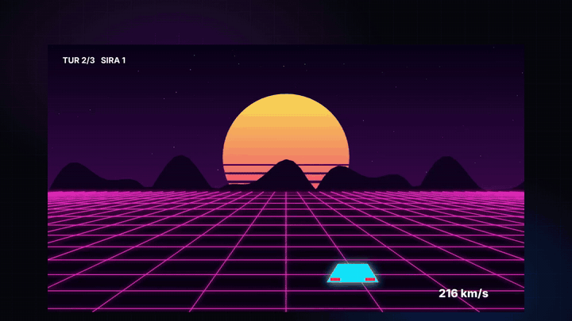
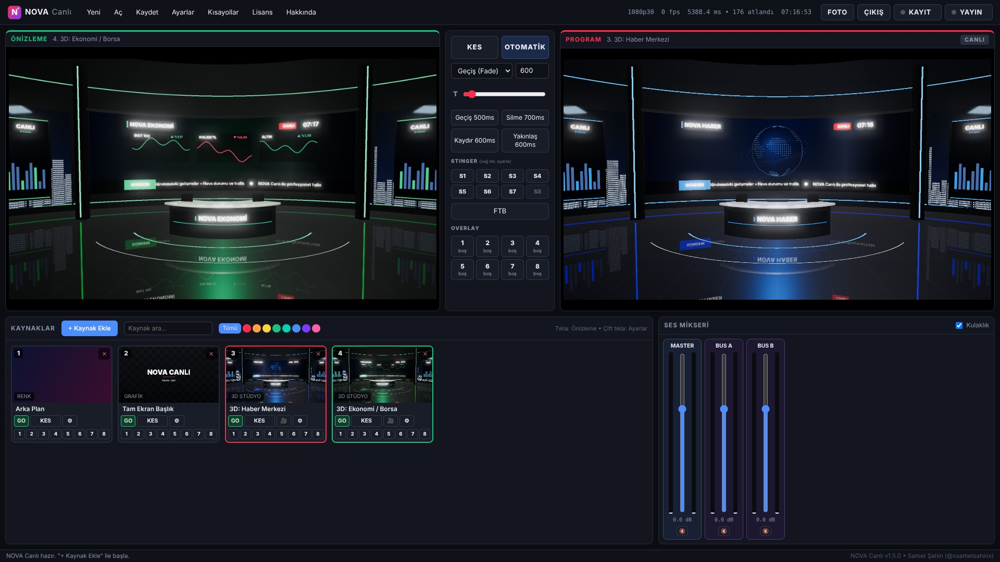

# NOVA Canlı

**vMix tarzı, ücretsiz canlı yayın ve prodüksiyon programı (Windows).**
Kamera, ekran, oyun, video ve grafikleri karıştır; YouTube, Twitch, Kick, Facebook ve TikTok'a aynı anda yayın yap.

Geliştirici: **Samet Şahin (@xsametsahinx)**

## 🎬 Tanıtım filmi

▶ **[Tanıtım filmini izle (53 sn, 1080p)](docs/NOVA-Canli-Tanitim.mp4)**

## ⬇️ İndir

**[Son sürümü indir → Releases](https://github.com/pepsicosamet-arch/NovaCanli/releases/latest)** — `NOVA-Canli-Setup-x.x.x.exe` dosyasını indirip kur. ffmpeg içinde gelir, ek bir şey kurman gerekmez.

## ✨ Özellikler

| Bölüm | Neler var |
|---|---|
| Kaynaklar | Kamera / yakalama kartı, ekran / pencere / oyun yakalama (+ sistem sesi), video ve **oynatma listesi**, resim/logo, **fotoğraf slayt gösterisi**, renk & degrade arka plan, mikrofon, müzik dosyası, **anlık tekrar**. Sürükle-bırak ile ekleme. |
| Önizleme / Program | vMix tarzı iki monitör. KES, OTOMATİK, T-bar ile elle geçiş, 4 hızlı geçiş butonu, FTB (siyaha karart). |
| Stinger (8) | 7 hazır animasyonlu stinger + kendi stinger videon (saydam WebM), süre ve kesme noktası ayarı, Ctrl+F1–F8. |
| Kaynak kartı | Kapat (✕), döngü (⟲), ayarlanabilir **GO** düğmesi, renk kategorisi, isim/renk ile arama-filtre. |
| Tetikleyiciler | Yayına girince/çıkınca, video bitince, geri sayım bitince/X sn kala → kes, geçiş, stinger, overlay, oynat, kayıt/yayın başlat-durdur… |
| Geçişler | Fade, AlfaGeçiş, Siyaha, Beyaza, Silme, Kaydır, İt, Yakınlaş, Daire — süre ayarlı. |
| Overlay | 8 overlay kanalı (F1–F8): alt yazı, logo, resim içinde resim (PIP), yeşil perdeli kamera. |
| Grafikler (33) | **Alt bant:** klasik, modern, cam, neon, sade, röportaj, konum • **Haber:** kayan yazı, haber bandı, son dakika, hava durumu, alıntı • **Spor:** skor, futbol skorbord (maç saatli), maç sonucu • **Yayın ekranı:** birazdan başlıyoruz, ara, yayın bitti, başlık, geri sayım • **Sosyal:** abone ol, sosyal döngü, izleyici mesajı, bağış uyarısı • **Araç:** CANLI rozeti, filigran, şimdi çalıyor, anket, hedef çubuğu, saat, kronometre. Hepsi animasyonlu, renkleri düzenlenebilir. |
| İsim listesi & altyazı | Alt bantlara çok sayıda isim (`Ad \| Unvan`), `N` ile sıradaki. Altyazı: satır satır ya da **SRT/VTT** ile zamanlı. |
| Sanal stüdyo (11) | Hareketli arka planlar: haber, talk show, oyun/neon, teknoloji, podcast, stadyum, konser, dalgalar, parçacıklar, uzay, kurumsal. |
| Sahne / çoklu görüntü | PIP, yan yana, 2x2, 1+2, üçlü, haber, röportaj, oyun yayını düzenleri; çerçeve, köşe, gölge, stüdyo arka planı. |
| Anlık tekrar | 4 açıya kadar (Program + kameralar) son 15–60 sn hafızada; `R` ile olay yakala, olaylara etiket ver ve ara, **Quad View** (4 açı), 0.25x–1x yavaş çekim. |
| Görüntü | Konum/boyut, kırpma, sığdır/doldur/esnet, parlaklık-kontrast-doygunluk, opaklık, ayna, **yeşil perde (GPU chroma key)**. |
| Ses mikseri | Kanal başına fader, sustur, AFV, kompresör, VU metreler; **Master + Bus A + Bus B** yönlendirme, yayın/kayıt/kulaklık için ayrı bus. |
| Yayın | RTMP/RTMPS: YouTube, Twitch, Kick, Facebook, Instagram, TikTok, özel sunucu. **Aynı anda çoklu platform.** |
| Kodlama | x264 (işlemci), NVIDIA NVENC, Intel QuickSync, AMD AMF; bit hızı/ön ayar seçimi. |
| Kayıt | MP4 veya MKV, hızlı (kopyala) ya da yeniden kodlama modu; yayınla aynı anda kayıt. |
| Otomatik güncelleme | Yeni sürüm GitHub'dan arka planda iner, program kapanınca kurulur (Ayarlar > Genel'den kapatılabilir). |
| Diğer | 1080p / 720p / 1440p / dikey 9:16 (TikTok-Reels), 25/30/50/60 fps, harici çıkış penceresi (projeksiyon / 2. monitör), PNG fotoğraf, proje kaydet/aç (`.nova`). |

## ⌨️ Kısayollar

`Enter` Kes • `Boşluk` Otomatik geçiş • `1–9` Önizlemeye al • `Shift+1–9` Direkt programa • `Ctrl+1–9` Hızlı geçiş • `F1–F8` Overlay • `Ctrl+F1–F8` Stinger • `Q` Tekrar Quad • `Alt+1–4` Tekrar açısı • `B` FTB • `R` Anlık tekrar • `N` / `Shift+N` Sonraki / önceki isim • `Ctrl+R` Kayıt • `Ctrl+S` Kaydet • `Ctrl+O` Aç • `F12` Fotoğraf

## 🛠️ Kaynak koddan çalıştırma

1. [Node.js LTS](https://nodejs.org) kur.
2. **`1_KUR_VE_CALISTIR.bat`** → paketleri indirir ve programı açar.
3. **`2_SETUP_EXE_OLUSTUR.bat`** → `dist\NOVA-Canli-Setup-x.x.x.exe` oluşturur.

Yeni sürüm yayınlamak için `package.json` içindeki sürümü artır (örn. `1.2.0`), `RELEASE_NOTES.md`'yi güncelle ve GitHub'a yükle; GitHub Actions Setup.exe'yi otomatik derleyip `v1.2.0` olarak Releases'e ekler.

## Teknik yapı

- `src/main.js` — Electron ana süreç: pencere, ekran yakalama listesi, dosya diyalogları, `nova://` medya sunucusu (video sarma destekli), ffmpeg süreç yönetimi.
- `src/ffargs.js` — yayın/kayıt ffmpeg komutları (tek ve çoklu yayın, `tee`).
- `src/renderer/js/app.js` — mikser motoru: Worker zamanlayıcılı sabit fps kompozisyon, geçişler, overlay'ler, anlık tekrar, oynatma listesi, Web Audio ses mikseri, MediaRecorder → ffmpeg çıkışı, arayüz.
- `src/renderer/js/titles.js` — grafik şablonları. Yeni şablon için `TITLE_TEMPLATES` + `render()` içine bir `case` ekle.
- `src/renderer/js/chroma.js` — WebGL yeşil perde.

Akış: kaynaklar → canvas (program) → `captureStream` + Web Audio master → MediaRecorder (WebM parçaları) → ffmpeg → RTMP / MP4.

---
© Samet Şahin — Instagram, TikTok, YouTube, X: **@xsametsahinx**
